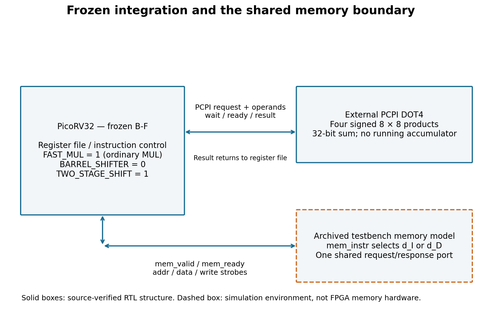

# RISC-V Packed INT8 DOT4 Accelerator

**Custom RISC-V instruction design, RTL implementation, processor integration, and performance evaluation for low-precision DSP workloads.**

An independent computer architecture research project by **Peiqi Xu**.

## Overview

This project explores the use of custom RISC-V instructions to accelerate low-precision digital signal processing (DSP) computations.

The prototype implements a packed signed INT8 dot-product instruction, **DOT4**, and integrates it into the lightweight [PicoRV32](https://github.com/YosysHQ/picorv32) processor through the Pico Co-Processor Interface (PCPI).

The work focuses on three research questions:

1. How can a custom packed arithmetic instruction be integrated into a RISC-V processor while preserving correct architectural behavior?
2. How much can instruction-level acceleration reduce execution cycles compared with optimized scalar software?
3. How do memory latency, instruction sequencing, and implementation costs influence the potential benefits of custom ISA extensions?

The repository includes synthesizable SystemVerilog, processor integration, software implementations, verification environments, reproducible performance experiments, and supporting research documentation.

## Architecture

### Custom DOT4 instruction

DOT4 accepts two 32-bit source operands, each containing four signed 8-bit integers.

It computes:

\[
\mathrm{DOT4}(A,B)=\sum_{i=0}^{3}\mathrm{int8}(A_i)\times\mathrm{int8}(B_i)
\]

The four signed products are summed and written to a 32-bit destination register.

The instruction performs neither accumulation with the previous destination value nor saturation.

### Processor integration

The prototype uses:

- **Processor:** PicoRV32, RV32I configuration
- **Extension interface:** Pico Co-Processor Interface (PCPI)
- **Arithmetic:** Four signed INT8 multiplications and summation
- **Implementation:** SystemVerilog RTL
- **Verification:** Arithmetic, interface, and processor-level testing

The evaluated processor configuration enables `FAST_MUL` and `TWO_STAGE_SHIFT`, with `BARREL_SHIFTER` disabled.



The design provides a practical platform for investigating custom instruction execution, CPU–accelerator interaction, and hardware–software trade-offs.

## Experimental Results

### Optimized scalar vs. custom DOT4

A controlled performance experiment compares an optimized scalar implementation (**S2**) with the custom DOT4 instruction.

Both implementations process the same input data and produce the same numerical result.

**Experimental configuration**

- Input length: `N = 1024`
- Operand format: packed signed INT8
- Fixed input generation and software configuration
- Two simulated memory-delay configurations
- Three process repetitions per implementation and configuration
- Independently checked numerical result: `5366`

### Measured execution cycles

| Memory delay (dI, dD) | Optimized scalar S2 | Custom DOT4 | Cycle-count reduction |
|---|---:|---:|---:|
| (0, 0) | 23,068 | 8,476 | **2.72×** |
| (0, 3) | 29,212 | 10,012 | **2.92×** |

The reported values are raw simulated execution cycles under the specified experimental configurations.

All twelve formal measurements returned the expected numerical result, with identical cycle counts across the three repetitions of each configuration.

### Interpretation

The experimental results demonstrate that a specialized packed arithmetic instruction can substantially reduce processor execution cycles for the evaluated dot-product kernel.

The observed benefit arises from replacing multiple scalar operations with a dedicated instruction that processes four signed INT8 operand pairs.

The results also motivate further investigation into:

- **Memory-latency sensitivity:** How different instruction and data access delays affect achievable acceleration.
- **Software mapping:** How scalar optimization and instruction scheduling influence the comparison with custom hardware.
- **Hardware–software trade-offs:** Whether cycle-count reductions justify additional logic resources and implementation complexity.
- **Workload characteristics:** Which DSP kernels can benefit most from packed arithmetic and reduced instruction overhead.

These are opportunities for further architectural investigation. The measured speedups apply to the evaluated prepacked-input workload and should not be interpreted as universal application-level performance improvements.

## Verification

The project includes several complementary verification levels.

| Stage | Verification focus |
|---|---|
| W1 | Python golden reference and arithmetic correctness |
| W2 | Standalone DOT4 RTL verification |
| W3 | PCPI interface behavior and completion protocol |
| W4 | CPU-level instruction execution and architectural correctness |
| W5 | Controlled scalar-versus-DOT4 performance evaluation |

The standalone RTL verification campaign includes **10,034 test cases**.

Processor-level verification includes instruction execution, register behavior, register overlap, and targeted instruction-adjacency scenarios.

The verification results support correctness within the documented test coverage; they do not constitute an exhaustive formal proof of all possible processor behaviors.

## Reproducing the Experiments

### Requirements

The qualified experiment environment uses Ubuntu 22.04 or a corresponding WSL environment.

| Dependency | Qualified version |
|---|---|
| Python | 3.10.12 |
| Verilator | 5.008 |
| GNU Make | 4.3 |
| G++ | 11.4.0 |
| CORE-V RISC-V GCC | 14.1.0 |
| RISC-V binutils | 2.42.50.20240416 |

The workflows also require the appropriate RISC-V toolchain components, Verilator runtime resources, and supporting build utilities.

See [Dependencies](docs/dependencies.md) for details.

### Run verification

From the repository root, after configuring the required tools:

```bash
# W1: Python arithmetic reference
python3 -B scripts/portable_workflow.py W1 --out w1-001

# W2: Standalone RTL
python3 -B scripts/portable_workflow.py W2 --out w2-001

# W3: PCPI integration
python3 -B scripts/portable_workflow.py W3 --out w3-001

# Parser regression
python3 -B scripts/parser_regression.py --out parser-001

# W4: CPU execution
python3 -B scripts/portable_workflow.py W4 --out w4-smoke-001 --riscv-prefix riscv32-corev-elf-

# W4: Targeted CPU verification
python3 -B scripts/run_targeted.py --out w4-targeted-001 --riscv-prefix riscv32-corev-elf-
```

### Run the performance experiment

```bash
# W5: S2 vs. DOT4
python3 -B scripts/portable_workflow.py W5 --out w5-001 --riscv-prefix riscv32-corev-elf-

# Independent measurement validation
python3 -B scripts/verify_w5.py --measurements _runs/w5-001/measurements.json --out w5-check-001
```

Use fresh output identifiers for new runs. Generated results are placed under `_runs/` and are not part of the tracked source package.

The recorded W1–W5 workflows were qualified in an isolated same-machine environment. Equivalent behavior on other tool versions or platforms has not been independently established.

See the [Reproduction Guide](docs/reproduction.md) for complete instructions and validation requirements.

## Repository Structure

```text
riscv-xdot4-accelerator/
├── rtl/                 # DOT4 RTL and processor integration
├── firmware/            # Scalar and DOT4 firmware
├── verification/        # RTL, PCPI and CPU test infrastructure
├── tests/               # Reference-model tests
├── scripts/             # Verification and measurement workflows
├── tools/               # Supporting utilities
├── data/
│   └── w5/              # Experimental inputs and measurements
├── docs/
│   ├── figures/         # Architecture and research figures
│   ├── reproduction.md  # Reproduction instructions
│   └── dependencies.md  # Dependencies and limitations
├── third_party/         # PicoRV32 upstream source and license
├── LICENSES/            # License texts
├── LICENSE-MAP.json     # File-level licensing information
└── ATTRIBUTION.md       # Authorship and attribution
```

## Research Documentation

A more detailed discussion of the architecture, verification methodology, experimental design, memory-latency considerations, and observed performance behavior is available in the [Research Reading Document](docs/research_reading_v0.1.md).

This document summarizes the research and its supporting evidence. It is not presented as a peer-reviewed publication.

The project emphasizes reproducible implementation, carefully defined experimental comparisons, and explicit separation between measured observations and architectural hypotheses.

## Research Scope and Future Work

This project is a functional research prototype rather than a production-ready DSP accelerator.

The current evidence supports instruction-level functional correctness and simulated cycle-count improvements within the evaluated configurations.

Future investigations may consider:

- Additional DSP kernels and input distributions.
- Data-packing overhead and complete application-level evaluation.
- Broader memory-latency and processor configurations.
- Alternative custom instruction microarchitectures.
- Quantitative performance–area trade-offs and timing optimization.
- External reproduction and comparison against related RISC-V DSP extensions.

Packed low-precision arithmetic is an established architectural technique. The intended contribution of this project is its documented design, integration, experimental characterization, and reproducible research process rather than a claim of inventing packed dot-product arithmetic.

## Licensing

This repository uses multiple licenses according to the type and provenance of each file.

| Material | License |
|---|---|
| Original RTL and hardware design | CERN-OHL-P-2.0 |
| Original software and verification scripts | Apache-2.0 |
| Original documentation, figures and applicable research data | CC BY 4.0 |
| Upstream PicoRV32 | ISC |

See [LICENSE-MAP.json](LICENSE-MAP.json) and [ATTRIBUTION.md](ATTRIBUTION.md) for exact file-level licensing boundaries and third-party attribution.

All upstream PicoRV32 copyright and license notices are preserved.

## Author and Acknowledgments

**Peiqi Xu**

Independent undergraduate research in RISC-V computer architecture, custom instruction-set extensions, RTL design, and DSP acceleration.

The project development and documentation involved assistance from Codex and ChatGPT. Technical decisions, experimental evaluation, and release scope were reviewed and directed by the researcher.

PicoRV32 is developed by its respective upstream contributors and remains subject to its original license.

## Citation

If you use this project, please cite the repository and identify the corresponding commit or release version.

Repository: [peiqixu17-bit/riscv-xdot4-accelerator](https://github.com/peiqixu17-bit/riscv-xdot4-accelerator)

---

*Exploring the relationship between specialized RISC-V instructions, processor execution behavior, and the practical trade-offs of low-precision DSP acceleration.*
