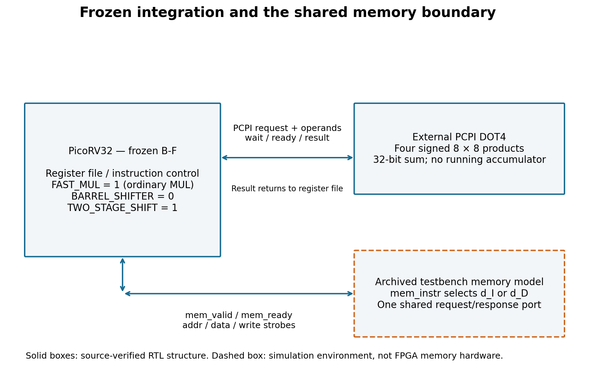
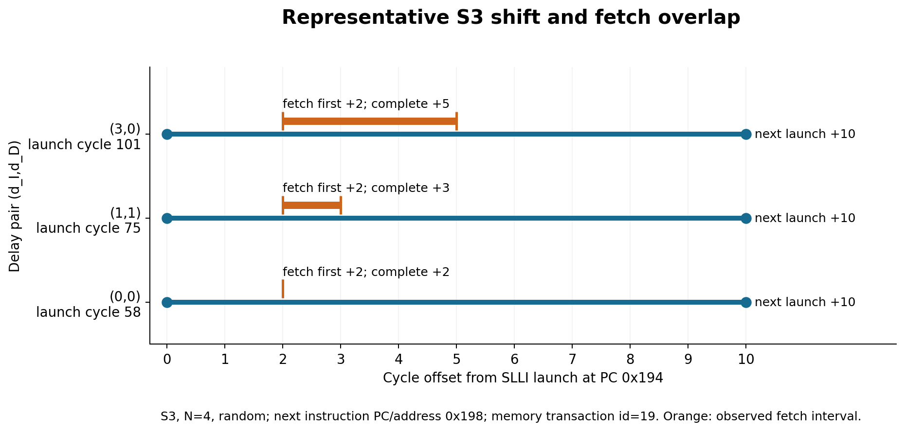

# DOT4 research reading draft v0.2

DRAFT — NOT RELEASE-APPROVED. Peiqi Xu.

This is a separately written abridged reading document based on the accepted internal report and P9 audited results, not the exact accepted manuscript. The complete accepted manuscript is preserved byte-for-byte in the private audit area. No claim of external academic acceptance, new arithmetic semantics, general DSP superiority or publication approval.

The architecture connects a signed INT8 DOT4 unit through PCPI to PicoRV32; fixed B-F enables FAST_MUL and uses TWO_STAGE_SHIFT=1/BARREL_SHIFTER=0. Instruction and data requests share one memory interface, classified by mem_instr.

W1 verified Python arithmetic; W2 standalone RTL covered10034 directed/lane/seeded cases with negative checks. W3 covered the bounded adapter protocol; it is not all possible protocol interleavings. W4 source-built CPU smoke plus nine targeted register/adjacency cases; the nine targeted cases covered10 DOT4 completions. These establish respective instruction/interface/CPU correctness within recorded scopes, not unrestricted hardware proof.

W5 is NEW_EXPERIMENTAL_CONFIGURATION, N1024, seed0x504a, CPython random.Random.getrandbits(8): generate A1024 then B1024, little-endian groups of4. Same source-built ELF and data; entry selector chooses S2 or DOT4. Expected5366. At(0,0), raw S2/DOT4=23068/8476=5767/2119≈2.721567; at(0,3),29212/10012=7303/2503≈2.917699. Each of12 formal runs retained, three deterministic repetitions equal, no best-run selection. Kernel counts23050/8458 and29194/9994 separately. Raw includes fixed counter/call/return overhead, not empty-subtracted. Deterministic repeats are not independent workload samples; no physical-time inference.

Historical M0/M1/M2 evidence is separate: M0 primary120/160; M1/M2 primary160/160 but exact0/160 and residual predicted-minus-observed+2 cycles each. Holdout comprises160 conditions but40 timing cases in20implementation/N groups; both retained pairs have d_I=1. Same programs and input patterns, not unseen-program or external independence. Raw residual localizes arithmetically outside kernel; kernel interpolation residual zero. The representative fetch/shift overlap is not complete causal attribution.

Separate E01/E02 S2/S3 extension:36conditions/108 historical runs, locked predictions exact; d_I=0 only. W=N/4>0: C_S2=28+W(90+8d_D), C_S3=28+W(188+2d_D). Difference W(98-6d_D), continuous model root49/3; observed integer rank reversal16→17 atN4/64/1024. Not a fractional-delay observation, not W5 DOT4 crossover, no new fitting to validation data, no extension to d_I=1. E01 pilot preceded E02; recorded ordering is not third-party timestamp attestation.

Hardware cost work was limited flow-specific FPGA characterization; full board timing closure, physical hardware validation, energy and operating-frequency gains are not established. Vendor reports/Figure8 excluded pending rights. Originality remains bounded pending literature/external evaluation. AI assistance: researcher declares original work created independently or with Codex/ChatGPT assistance; this is a declaration, not independent legal certification. W6 establishes archived numerical reconstruction only, not fresh CPU reproduction or external independent reproduction.

## Current evidence and release scope — 0.1.5-private-s08r01

S06-LIMITED qualified W1–W5 from revision 0.1.1 in a fresh same-machine Ubuntu/WSL copy. The executable sources and eight reproduction commands are unchanged in this revision; no new run is claimed. This is not external independent reproduction. Full ELF/simulator bytes were not reproducible because of documented build metadata/source paths, although machine-code images, inputs, fixtures and the scoped results matched.

W6 historical internal numerical reconstruction is separate evidence. The portable public Tier 1 consumer is incomplete; Tier 2 event reconstruction and restricted internal datasets are excluded. No W6 dataset is provided by this candidate, and no external private data directory is required for W1–W5. FPGA reproduction, board validation, full physical timing closure, energy and general DSP benefit are not established.

Current licensing is implemented through LICENSE-MAP.json and ATTRIBUTION.md: original RTL under CERN-OHL-P-2.0, original software under Apache-2.0, and original documentation/figures/data under CC-BY-4.0. PicoRV32 retains its ISC notices. A09 firmware/link.ld original portions are covered by Apache-2.0 on Peiqi Xu's first-hand declaration and a narrow check finding no specific conflicting evidence; authorship is not independently certified. Historical Q12 remains unresolved, with no inferred rights for other linker files. Historical Q18 fixtures remain excluded. Copyright years are not invented.

This revision changes delivery documentation only. Public Release remains NO-GO pending separate authorization. Historical review notices remain in the private audit, not in this current scientific summary.
